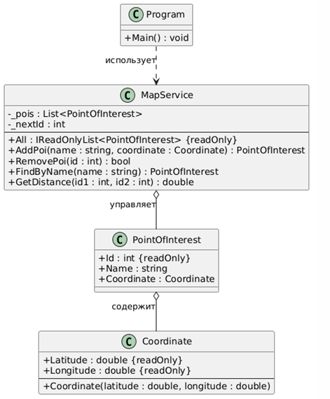

# Лабораторные работы по дисциплине «Паттерны проектирования»

Репозиторий содержит 15 лабораторных работ по курсу «Паттерны проектирования».

**Вариант 1** — «Интерактивная карта» (консольное приложение).

**Стек:** .NET 10, C#, ASP.NET Core (Lab12–Lab14).

## Содержание

| № | Название | Паттерны | Отчёт |
|---|---|---|---|
| 1 | Порождающие паттерны | Singleton, Builder | [README](readme/lab01/README.md) · [docx](docs/лаб1.docx) |
| 2 | Порождающие паттерны | Abstract Factory, Factory Method | [README](readme/lab02/README.md) · [docx](docs/лаб2.docx) |
| 3 | Структурные паттерны | Adapter, Bridge | [README](readme/lab03/README.md) · [docx](docs/лаб3.docx) |
| 4 | Структурные паттерны | Composite, Decorator | [README](readme/lab04/README.md) · [docx](docs/лаб4.docx) |
| 5 | Структурные паттерны | Facade, Flyweight | [README](readme/lab05/README.md) · [docx](docs/лаб5.docx) |
| 6 | Структурные паттерны | Proxy | [README](readme/lab06/README.md) · [docx](docs/лаб6.docx) |
| 7 | Поведенческие паттерны | Command, Iterator | [README](readme/lab07/README.md) · [docx](docs/лаб7.docx) |
| 8 | Поведенческие паттерны | Chain of Responsibility | [README](readme/lab08/README.md) · [docx](docs/лаб8.docx) |
| 9 | Поведенческие паттерны | Mediator, Memento | [README](readme/lab09/README.md) · [docx](docs/лаб9.docx) |
| 10 | Поведенческие паттерны | Observer, State | [README](readme/lab10/README.md) · [docx](docs/лаб10.docx) |
| 11 | Поведенческие паттерны | Strategy, Template Method | [README](readme/lab11/README.md) · [docx](docs/лаб11.docx) |
| 12 | Архитектурные паттерны | MVC | [README](readme/lab12/README.md) · [docx](docs/лаб12.docx) |
| 13 | Паттерны микросервисов | Saga (Orchestration) | [README](readme/lab13/README.md) · [docx](docs/лаб13.docx) |
| 14 | Системные паттерны | Repository | [README](readme/lab14/README.md) · [docx](docs/лаб14.docx) |
| 15 | Идиоматические паттерны | Producer/Consumer | [README](readme/lab15/README.md) · [docx](docs/лаб15.docx) |
