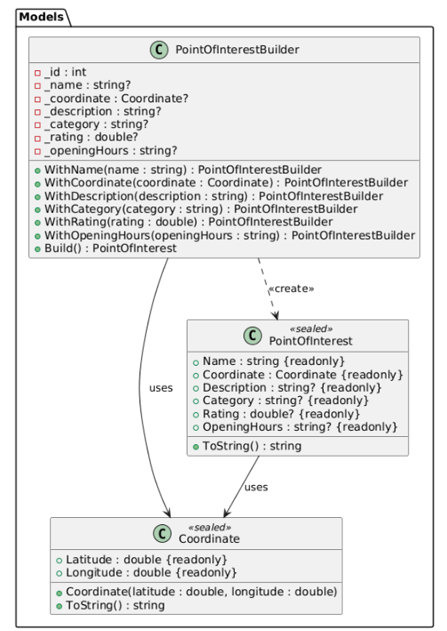
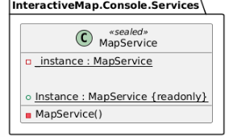

# Лабораторная работа 1. Порождающие паттерны: Одиночка, Строитель

## Паттерн

**Singleton (Одиночка)** и **Builder (Строитель)** — порождающие паттерны GoF.

## Что было сделано

Реализованы оба порождающих паттерна в консольном приложении «Интерактивная карта»:

- **Singleton** — [`MapService.cs`](https://github.com/uu546/DesignPatternLabDerevyashkinVV/blob/main/InteractiveMap.Console/Services/MapService.cs) стал единственным реестром точек интереса. Приватный конструктор запрещает создание второго экземпляра. Благодаря этому все операции над картой (добавление, удаление, поиск, расчёт расстояния) работают с одним и тем же состоянием.
- **Builder** — [`PointOfInterestBuilder.cs`](https://github.com/uu546/DesignPatternLabDerevyashkinVV/blob/main/InteractiveMap.Console/Models/PointOfInterestBuilder.cs) реализует fluent-интерфейс для пошагового создания точки с опциональными полями. Обязательные поля (`Name`, `Coordinate`) и диапазон рейтинга валидируются в методе `Build()`.

## Диаграмма классов

Builder

Singleton

## Связь с предметной областью

В приложении «Интерактивная карта» Singleton гарантирует единый реестр точек интереса, а Builder упрощает создание точек с множеством опциональных параметров. Паттерны дополняют друг друга: Builder готовит точку, Singleton-реестр её принимает.
