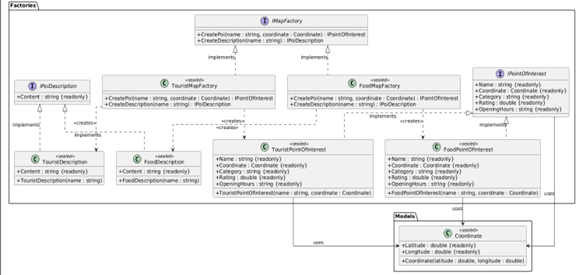
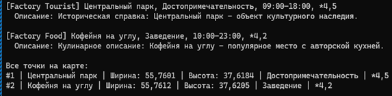

# Лабораторная работа 2. Порождающие паттерны: Абстрактная фабрика, Фабричный метод, Прототип

## Паттерн

**Abstract Factory (Абстрактная фабрика)** и **Factory Method (Фабричный метод)** — порождающие паттерны GoF.

## Что было сделано

Реализованы два порождающих паттерна, работающих в связке:

- **Abstract Factory** — [`IMapFactory.cs`](https://github.com/uu546/DesignPatternLabDerevyashkinVV/blob/main/InteractiveMap.Console/Factories/IMapFactory.cs) задаёт семейство из двух взаимосвязанных продуктов: точки интереса ([`IPointOfInterest.cs`](https://github.com/uu546/DesignPatternLabDerevyashkinVV/blob/main/InteractiveMap.Console/Factories/IPointOfInterest.cs)) и её текстового описания ([`IPoiDescription.cs`](https://github.com/uu546/DesignPatternLabDerevyashkinVV/blob/main/InteractiveMap.Console/Factories/IPoiDescription.cs)). Конкретные фабрики — [`TouristMapFactory.cs`](https://github.com/uu546/DesignPatternLabDerevyashkinVV/blob/main/InteractiveMap.Console/Factories/TouristMapFactory.cs) и [`FoodMapFactory.cs`](https://github.com/uu546/DesignPatternLabDerevyashkinVV/blob/main/InteractiveMap.Console/Factories/FoodMapFactory.cs) — создают согласованные семейства продуктов.
- **Factory Method** — методы `CreatePoi` и `CreateDescription` в конкретных фабриках являются фабричными методами: каждая фабрика сама решает, с какими значениями свойств создавать точку ([`TouristPointOfInterest.cs`](https://github.com/uu546/DesignPatternLabDerevyashkinVV/blob/main/InteractiveMap.Console/Factories/TouristPointOfInterest.cs), [`FoodPointOfInterest.cs`](https://github.com/uu546/DesignPatternLabDerevyashkinVV/blob/main/InteractiveMap.Console/Factories/FoodPointOfInterest.cs)) и каким стилем писать описание. Клиент работает через интерфейс `IMapFactory` и не зависит от конкретных реализаций.

## Диаграмма классов

Абстрактная фабрика с фабричными методами

## Скриншоты работы

## Связь с предметной областью

В приложении «Интерактивная карта» разные стили карт (туристическая и гастрономическая) реализуются как семейства продуктов абстрактной фабрики. Каждое семейство согласовано: точка туристической карты всегда идёт с историческим описанием, точка гастрономической — с кулинарным. Фабричный метод отвечает за создание каждого конкретного продукта внутри семейства.
