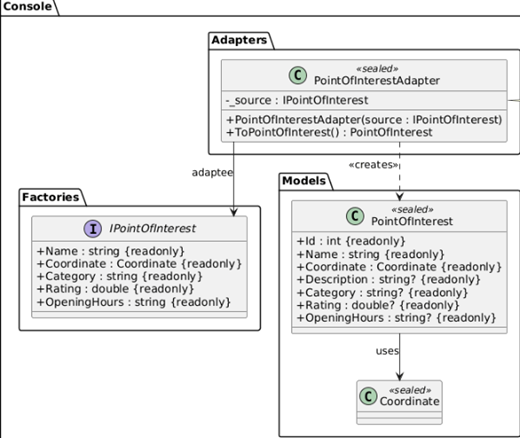
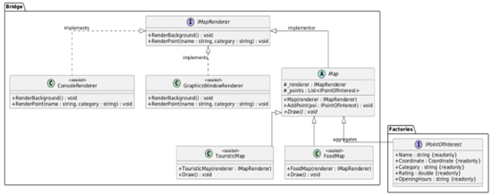
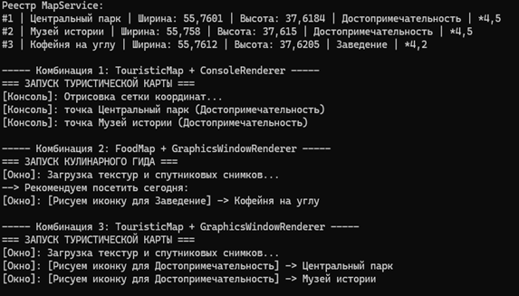

# Лабораторная работа 3. Структурные паттерны: Адаптер, Мост

## Паттерн

**Adapter (Адаптер)** и **Bridge (Мост)** — структурные паттерны GoF.

## Что было сделано

Реализованы два структурных паттерна, решающих независимые задачи в консольном приложении «Интерактивная карта»:

- **Adapter** — [`PointOfInterestAdapter.cs`](https://github.com/uu546/DesignPatternLabDerevyashkinVV/blob/main/InteractiveMap.Console/Adapters/PointOfInterestAdapter.cs) устраняет несовместимость двух интерфейсов: продукты фабрик ([`IPointOfInterest.cs`](https://github.com/uu546/DesignPatternLabDerevyashkinVV/blob/main/InteractiveMap.Console/Factories/IPointOfInterest.cs)) и модель реестра ([`PointOfInterest.cs`](https://github.com/uu546/DesignPatternLabDerevyashkinVV/blob/main/InteractiveMap.Console/Models/PointOfInterest.cs)). Адаптер инкапсулирует конвертацию в одном классе, убирая ручную сборку через Builder из клиентского кода.
- **Bridge** — разделяет две независимые иерархии: вид карты (абстракция — [`Map.cs`](https://github.com/uu546/DesignPatternLabDerevyashkinVV/blob/main/InteractiveMap.Console/Bridge/Map.cs), [`TouristicMap.cs`](https://github.com/uu546/DesignPatternLabDerevyashkinVV/blob/main/InteractiveMap.Console/Bridge/TouristicMap.cs), [`FoodMap.cs`](https://github.com/uu546/DesignPatternLabDerevyashkinVV/blob/main/InteractiveMap.Console/Bridge/FoodMap.cs)) и способ отрисовки (реализация — [`IMapRenderer.cs`](https://github.com/uu546/DesignPatternLabDerevyashkinVV/blob/main/InteractiveMap.Console/Bridge/IMapRenderer.cs), [`ConsoleRenderer.cs`](https://github.com/uu546/DesignPatternLabDerevyashkinVV/blob/main/InteractiveMap.Console/Bridge/ConsoleRenderer.cs), [`GraphicsWindowRenderer.cs`](https://github.com/uu546/DesignPatternLabDerevyashkinVV/blob/main/InteractiveMap.Console/Bridge/GraphicsWindowRenderer.cs)). Абстракция хранит ссылку на реализацию, что позволяет комбинировать виды карт и способы отрисовки без создания `N × M` классов.

## Диаграмма классов

Адаптер

Мост

## Скриншоты работы

## Связь с предметной областью

В приложении «Интерактивная карта» адаптер позволяет единообразно регистрировать точки, созданные разными фабриками, в общем реестре. Мост разделяет «что отображаем» (туристическая или гастрономическая карта) и «как отображаем» (консоль или графическое окно), так что добавление нового вида карты или нового рендерера требует только одного нового класса вместо множества комбинаций.