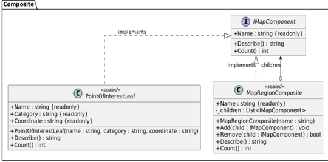
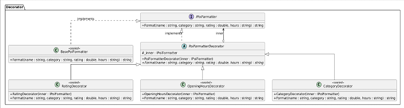
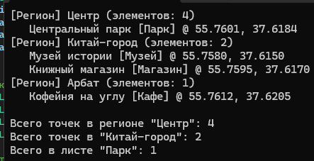
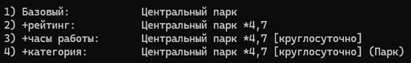

# Лабораторная работа 4. Структурные паттерны: Компоновщик, Декоратор

## Паттерн

**Composite (Компоновщик)** и **Decorator (Декоратор)** — структурные паттерны GoF.

## Что было сделано

Реализованы два структурных паттерна, решающих разные задачи в консольном приложении «Интерактивная карта»:

- **Composite** — [`IMapComponent.cs`](https://github.com/uu546/DesignPatternLabDerevyashkinVV/blob/main/InteractiveMap.Console/Composite/IMapComponent.cs) задаёт общий интерфейс для листа и группы. Лист — [`PointOfInterestLeaf.cs`](https://github.com/uu546/DesignPatternLabDerevyashkinVV/blob/main/InteractiveMap.Console/Composite/PointOfInterestLeaf.cs) — представляет точку интереса, а композит — [`MapRegionComposite.cs`](https://github.com/uu546/DesignPatternLabDerevyashkinVV/blob/main/InteractiveMap.Console/Composite/MapRegionComposite.cs) — регион карты, который может содержать как точки, так и подрегионы. Клиент вызывает `Describe()` и `Count()` на любом узле дерева, не зная, лист это или группа.
- **Decorator** — [`IPoiFormatter.cs`](https://github.com/uu546/DesignPatternLabDerevyashkinVV/blob/main/InteractiveMap.Console/Decorator/IPoiFormatter.cs) задаёт общий интерфейс форматирования, [`BasePoiFormatter.cs`](https://github.com/uu546/DesignPatternLabDerevyashkinVV/blob/main/InteractiveMap.Console/Decorator/BasePoiFormatter.cs) — базовый форматтер, а [`PoiFormatterDecorator.cs`](https://github.com/uu546/DesignPatternLabDerevyashkinVV/blob/main/InteractiveMap.Console/Decorator/PoiFormatterDecorator.cs) — абстрактная обёртка. Конкретные декораторы — [`RatingDecorator.cs`](https://github.com/uu546/DesignPatternLabDerevyashkinVV/blob/main/InteractiveMap.Console/Decorator/RatingDecorator.cs), [`OpeningHoursDecorator.cs`](https://github.com/uu546/DesignPatternLabDerevyashkinVV/blob/main/InteractiveMap.Console/Decorator/OpeningHoursDecorator.cs), [`CategoryDecorator.cs`](https://github.com/uu546/DesignPatternLabDerevyashkinVV/blob/main/InteractiveMap.Console/Decorator/CategoryDecorator.cs) — динамически добавляют к выводу точки рейтинг, часы работы и категорию в любой комбинации.

## Диаграмма классов

Компоновщик дерева регионов 

Декоратор форматирования точек

## Скриншоты работы

Composite

Decorator

## Связь с предметной областью

В приложении «Интерактивная карта» компоновщик представляет карту как дерево «регион → подрегион → точка», позволяя единообразно работать с отдельной точкой и целым регионом. Декоратор динамически навешивает на вывод точки дополнительные детали (рейтинг, часы, категорию) в произвольной комбинации — без создания отдельных подклассов под каждое сочетание опций.