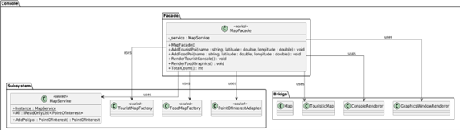
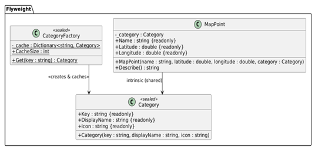
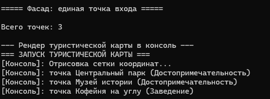
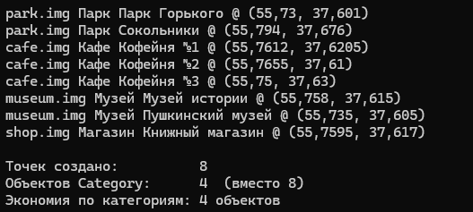

# Лабораторная работа 5. Структурные паттерны: Фасад, Приспособленец

## Паттерн

**Facade (Фасад)** и **Flyweight (Приспособленец)** — структурные паттерны GoF.

## Что было сделано

Реализованы два структурных паттерна, решающих разные задачи в консольном приложении «Интерактивная карта»:

- **Facade** — [`MapFacade.cs`](https://github.com/uu546/DesignPatternLabDerevyashkinVV/blob/main/InteractiveMap.Console/Facade/MapFacade.cs) предоставляет единый вход в подсистему «Интерактивная карта», скрывая от клиента фабрики, адаптер, реестр и Bridge-рендереры. Высокоуровневые операции `AddTouristPoi`, `AddFoodPoi`, `RenderTouristConsole`, `RenderFoodGraphics` позволяют клиенту работать с картой, не зная её внутреннего устройства. Вспомогательный [`PoiLeafAdapter.cs`](https://github.com/uu546/DesignPatternLabDerevyashkinVV/blob/main/InteractiveMap.Console/Facade/PoiLeafAdapter.cs) используется внутри фасада для интеграции реестра с Bridge-рендерером.
- **Flyweight** — [`Category.cs`](https://github.com/uu546/DesignPatternLabDerevyashkinVV/blob/main/InteractiveMap.Console/Flyweight/Category.cs) хранит внутреннее (intrinsic) состояние категории — ключ, отображаемое имя и иконку, разделяемое между всеми точками одной категории. [`CategoryFactory.cs`](https://github.com/uu546/DesignPatternLabDerevyashkinVV/blob/main/InteractiveMap.Console/Flyweight/CategoryFactory.cs) — фабрика с кэшем, гарантирующая, что для каждого ключа существует ровно один объект `Category`. [`MapPoint.cs`](https://github.com/uu546/DesignPatternLabDerevyashkinVV/blob/main/InteractiveMap.Console/Flyweight/MapPoint.cs) хранит внешнее (extrinsic) состояние — имя и координаты конкретной точки — и ссылается на разделяемую категорию.

## Диаграмма классов

Facade над подсистемой карты 

Flyweight(Приспособленец) категорий точек

## Скриншоты работы

Facade

Flyweight

## Связь с предметной областью

В приложении «Интерактивная карта» фасад даёт клиенту одну точку входа для типовых операций над картой, скрывая всё многообразие внутренних сервисов. Приспособленец решает проблему памяти: категорий точек мало, а самих точек — много, поэтому общее состояние категорий (название, иконка) разделяется между тысячами объектов `MapPoint`, а уникальные данные (имя, координаты) хранятся отдельно.