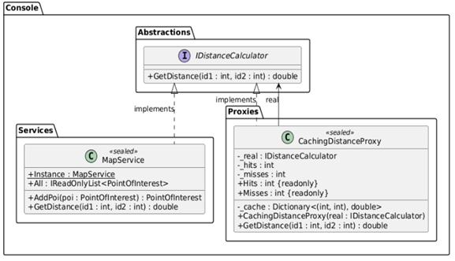
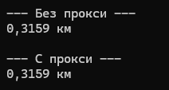

# Лабораторная работа 6. Структурные паттерны: Заместитель

## Паттерн

**Proxy (Заместитель)** — структурный паттерн GoF.

## Что было сделано

Реализован паттерн **Proxy** в форме кэширующего заместителя (Caching Proxy) вокруг расчёта расстояния между точками:

- **Subject** — [`IDistanceCalculator.cs`](https://github.com/uu546/DesignPatternLabDerevyashkinVV/blob/main/InteractiveMap.Console/Abstractions/IDistanceCalculator.cs) — общий интерфейс для реального калькулятора и его прокси.
- **RealSubject** — [`MapService.cs`](https://github.com/uu546/DesignPatternLabDerevyashkinVV/blob/main/InteractiveMap.Console/Services/MapService.cs) — выполняет реальный расчёт расстояния по формуле гаверсинуса.
- **Proxy** — [`CachingDistanceProxy.cs`](https://github.com/uu546/DesignPatternLabDerevyashkinVV/blob/main/InteractiveMap.Console/Proxies/CachingDistanceProxy.cs) — реализует тот же интерфейс, хранит ссылку на `RealSubject` и кэширует результат по нормализованному ключу `(min, max)`. Учитывает симметрию расстояния (`(a,b) == (b,a)`), ведёт статистику попаданий и промахов, при промахе делегирует вызов в `RealSubject`.

Клиент работает через интерфейс `IDistanceCalculator` и не знает, что под ним прокси. Повторные вызовы одной и той же пары не выполняют тяжёлый тригонометрический расчёт.

## Диаграмма классов

Кэширующий заместитель над расчётом расстояния

## Скриншоты работы

Proxy

## Связь с предметной областью

В приложении «Интерактивная карта» расчёт расстояния между точками — относительно дорогая операция (тригонометрия по формуле гаверсинуса), и при массовых запросах (построение матрицы расстояний, маршруты) одна и та же пара может вычисляться повторно. Кэширующий заместитель прозрачно для клиента ускоряет повторные вызовы и корректно учитывает симметрию расстояния, не меняя интерфейс `MapService`.