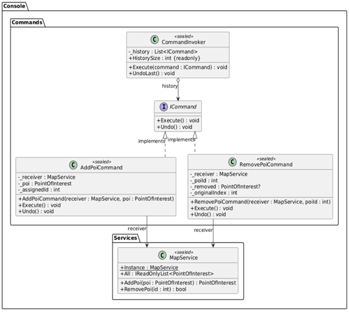
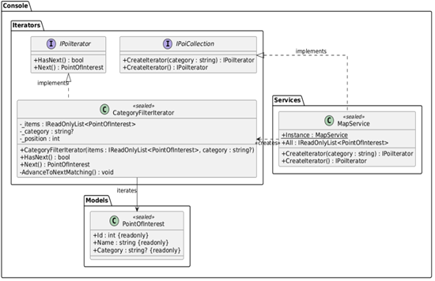
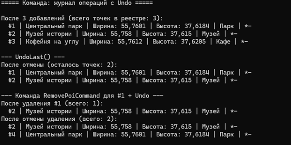
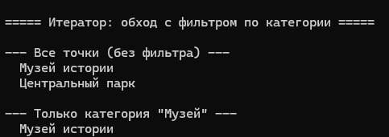

# Лабораторная работа 7. Поведенческие паттерны: Команда, Итератор

## Паттерн

**Command (Команда)** и **Iterator (Итератор)** — поведенческие паттерны GoF.

## Что было сделано

Реализованы два поведенческих паттерна, решающих разные задачи в консольном приложении «Интерактивная карта»:

- **Command** — [`ICommand.cs`](https://github.com/uu546/DesignPatternLabDerevyashkinVV/blob/main/InteractiveMap.Console/Commands/ICommand.cs) задаёт общий интерфейс с методами `Execute` и `Undo`. Конкретные команды — [`AddPoiCommand.cs`](https://github.com/uu546/DesignPatternLabDerevyashkinVV/blob/main/InteractiveMap.Console/Commands/AddPoiCommand.cs) и [`RemovePoiCommand.cs`](https://github.com/uu546/DesignPatternLabDerevyashkinVV/blob/main/InteractiveMap.Console/Commands/RemovePoiCommand.cs) — инкапсулируют операции над реестром (`MapService`) с поддержкой отмены. Invoker — [`CommandInvoker.cs`](https://github.com/uu546/DesignPatternLabDerevyashkinVV/blob/main/InteractiveMap.Console/Commands/CommandInvoker.cs) — хранит историю команд и умеет откатывать последнюю, не зная деталей каждой команды.
- **Iterator** — [`IPoiIterator.cs`](https://github.com/uu546/DesignPatternLabDerevyashkinVV/blob/main/InteractiveMap.Console/Iterators/IPoiIterator.cs) задаёт интерфейс обхода (`HasNext`, `Next`), [`IPoiCollection.cs`](https://github.com/uu546/DesignPatternLabDerevyashkinVV/blob/main/InteractiveMap.Console/Iterators/IPoiCollection.cs) — интерфейс агрегата с фабрикой итераторов. Конкретный итератор — [`CategoryFilterIterator.cs`](https://github.com/uu546/DesignPatternLabDerevyashkinVV/blob/main/InteractiveMap.Console/Iterators/CategoryFilterIterator.cs) — обходит коллекцию точек, пропуская элементы, не подходящие по категории. `MapService` реализует `IPoiCollection`, предоставляя обход без раскрытия внутренней структуры хранилища.

## Диаграмма классов

Журнал команд с отменой(command) 

Итератор(itrator) с фильтром по категории

## Скриншоты работы

Command

Iterator

## Связь с предметной областью

В приложении «Интерактивная карта» команды инкапсулируют операции над реестром точек (добавление, удаление) и позволяют откатывать последнее действие — это основа для редактора карты с поддержкой Undo. Итератор предоставляет собственный обход точек с фильтрацией по категории, не раскрывая внутреннее устройство `MapService` и позволяя добавлять новые стратегии обхода без изменения реестра.