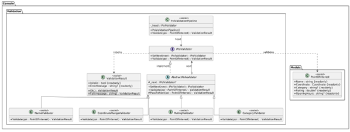

# Лабораторная работа 8. Поведенческие паттерны: Цепочка обязанностей

## Паттерн

**Chain of Responsibility (Цепочка обязанностей)** — поведенческий паттерн GoF.

## Что было сделано

Реализован паттерн **Chain of Responsibility** в форме конвейера валидаторов точек интереса:

- **Handler** — [`IPoiValidator.cs`](https://github.com/uu546/DesignPatternLabDerevyashkinVV/blob/main/InteractiveMap.Console/Validation/IPoiValidator.cs) — общий интерфейс с методами `SetNext` и `Validate`.
- **Base Handler** — [`AbstractPoiValidator.cs`](https://github.com/uu546/DesignPatternLabDerevyashkinVV/blob/main/InteractiveMap.Console/Validation/AbstractPoiValidator.cs) — реализует логику передачи запроса следующему обработчику, чтобы конкретные валидаторы её не дублировали.
- **ConcreteHandler'ы** — [`NameValidator.cs`](https://github.com/uu546/DesignPatternLabDerevyashkinVV/blob/main/InteractiveMap.Console/Validation/NameValidator.cs), [`CoordinateRangeValidator.cs`](https://github.com/uu546/DesignPatternLabDerevyashkinVV/blob/main/InteractiveMap.Console/Validation/CoordinateRangeValidator.cs), [`RatingValidator.cs`](https://github.com/uu546/DesignPatternLabDerevyashkinVV/blob/main/InteractiveMap.Console/Validation/RatingValidator.cs), [`CategoryValidator.cs`](https://github.com/uu546/DesignPatternLabDerevyashkinVV/blob/main/InteractiveMap.Console/Validation/CategoryValidator.cs) — каждый отвечает за одну проверку и либо возвращает ошибку ([`ValidationResult.cs`](https://github.com/uu546/DesignPatternLabDerevyashkinVV/blob/main/InteractiveMap.Console/Validation/ValidationResult.cs)), либо передаёт запрос дальше.
- **Client (сборщик цепочки)** — [`PoiValidationPipeline.cs`](https://github.com/uu546/DesignPatternLabDerevyashkinVV/blob/main/InteractiveMap.Console/Validation/PoiValidationPipeline.cs) — собирает цепочку в нужном порядке и запускает валидацию с головы.

## Диаграмма классов

Цепочка валидаторов точки интереса

## Скриншоты работы

## Связь с предметной областью

В приложении «Интерактивная карта» цепочка обязанностей защищает реестр от некорректных данных до регистрации точки. Каждая проверка (имя, диапазон координат, рейтинг, категория) вынесена в отдельный класс — это позволяет добавлять новые правила валидации без правки существующих и легко менять порядок проверок в рантайме.