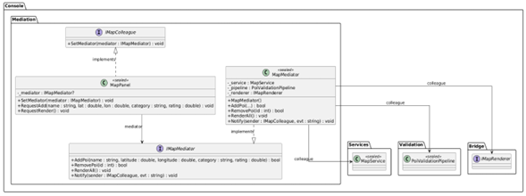
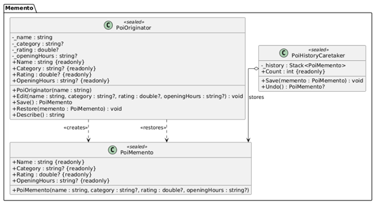
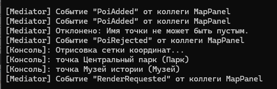
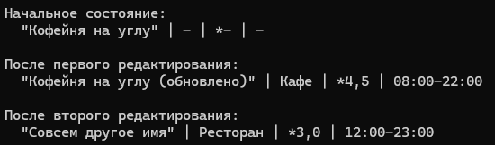

# Лабораторная работа 9. Поведенческие паттерны: Посредник, Снимок

## Паттерн

**Mediator (Посредник)** и **Memento (Снимок)** — поведенческие паттерны GoF.

## Что было сделано

Реализованы два поведенческих паттерна, решающих разные задачи в консольном приложении «Интерактивная карта»:

- **Mediator** — [`IMapMediator.cs`](https://github.com/uu546/DesignPatternLabDerevyashkinVV/blob/main/InteractiveMap.Console/Mediation/IMapMediator.cs) задаёт интерфейс взаимодействия с коллегами. Конкретный посредник — [`MapMediator.cs`](https://github.com/uu546/DesignPatternLabDerevyashkinVV/blob/main/InteractiveMap.Console/Mediation/MapMediator.cs) — централизует логику «валидация → регистрация → рендер», связывая `MapService`, `PoiValidationPipeline` и `IMapRenderer`. Коллега — [`MapPanel.cs`](https://github.com/uu546/DesignPatternLabDerevyashkinVV/blob/main/InteractiveMap.Console/Mediation/MapPanel.cs) — знает только о посреднике ([`IMapColleague.cs`](https://github.com/uu546/DesignPatternLabDerevyashkinVV/blob/main/InteractiveMap.Console/Mediation/IMapColleague.cs)) и не обращается к подсистемам напрямую.
- **Memento** — [`PoiMemento.cs`](https://github.com/uu546/DesignPatternLabDerevyashkinVV/blob/main/InteractiveMap.Console/Memento/PoiMemento.cs) хранит снимок состояния точки с неизменяемыми извне полями (конструктор `internal`). Originator — [`PoiOriginator.cs`](https://github.com/uu546/DesignPatternLabDerevyashkinVV/blob/main/InteractiveMap.Console/Memento/PoiOriginator.cs) — создаёт снимок через `Save()` и восстанавливается из него через `Restore()`. Caretaker — [`PoiHistoryCaretaker.cs`](https://github.com/uu546/DesignPatternLabDerevyashkinVV/blob/main/InteractiveMap.Console/Memento/PoiHistoryCaretaker.cs) — хранит стек снимков, не читая их содержимое.

## Диаграмма классов

Посредник(mediator) над подсистемой карты

Снимок(memmento) состояния точки

## Скриншоты работы

Mediator

Momento

## Связь с предметной областью

В приложении «Интерактивная карта» посредник избавляет панель управления от жёсткой связи с реестром, валидатором и рендерером — все взаимодействия идут через `MapMediator`. Снимок позволяет редактировать точку интереса и откатывать изменения к предыдущему состоянию, не раскрывая внутреннее устройство `PoiOriginator` и сохраняя инкапсуляцию.