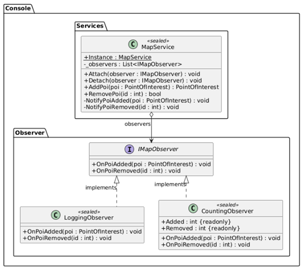
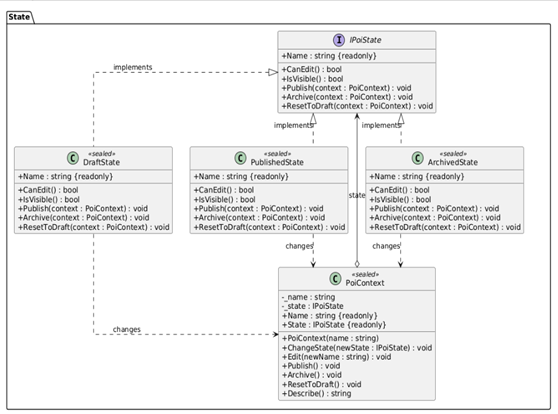
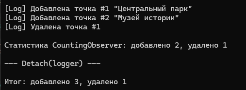
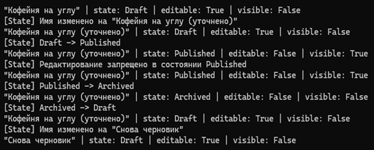

# Лабораторная работа 10. Поведенческие паттерны: Наблюдатель, Состояние

## Паттерн

**Observer (Наблюдатель)** и **State (Состояние)** — поведенческие паттерны GoF.

## Что было сделано

Реализованы два поведенческих паттерна, решающих разные задачи в консольном приложении «Интерактивная карта»:

- **Observer** — [`IMapObserver.cs`](https://github.com/uu546/DesignPatternLabDerevyashkinVV/blob/main/InteractiveMap.Console/Observer/IMapObserver.cs) задаёт интерфейс подписчиков на изменения реестра. Конкретные наблюдатели — [`LoggingObserver.cs`](https://github.com/uu546/DesignPatternLabDerevyashkinVV/blob/main/InteractiveMap.Console/Observer/LoggingObserver.cs) (логирует добавление и удаление точек) и [`CountingObserver.cs`](https://github.com/uu546/DesignPatternLabDerevyashkinVV/blob/main/InteractiveMap.Console/Observer/CountingObserver.cs) (ведёт счётчики). Subject — [`MapService.cs`](https://github.com/uu546/DesignPatternLabDerevyashkinVV/blob/main/InteractiveMap.Console/Services/MapService.cs) — при `AddPoi`/`RemovePoi` рассылает уведомления всем подписчикам, поддерживает `Attach`/`Detach` для динамической подписки.
- **State** — [`IPoiState.cs`](https://github.com/uu546/DesignPatternLabDerevyashkinVV/blob/main/InteractiveMap.Console/State/IPoiState.cs) задаёт общий интерфейс поведения точки в зависимости от её жизненного цикла. Конкретные состояния — [`DraftState.cs`](https://github.com/uu546/DesignPatternLabDerevyashkinVV/blob/main/InteractiveMap.Console/State/DraftState.cs), [`PublishedState.cs`](https://github.com/uu546/DesignPatternLabDerevyashkinVV/blob/main/InteractiveMap.Console/State/PublishedState.cs), [`ArchivedState.cs`](https://github.com/uu546/DesignPatternLabDerevyashkinVV/blob/main/InteractiveMap.Console/State/ArchivedState.cs) — каждое само решает, можно ли редактировать точку, видна ли она и куда разрешён переход. Context — [`PoiContext.cs`](https://github.com/uu546/DesignPatternLabDerevyashkinVV/blob/main/InteractiveMap.Console/State/PoiContext.cs) — хранит текущее состояние и делегирует ему операции.

## Диаграмма классов

Наблюдатели(observer) реестра 

Жизненный цикл точки через состояния(state)

## Скриншоты работы

Наблюдатели(observer) реестра 

Жизненный цикл точки через состояния(state)

## Связь с предметной областью

В приложении «Интерактивная карта» наблюдатель позволяет добавлять подписчиков на события реестра (логгер, счётчик, будущие UI-компоненты) без правки `MapService`. Состояние реализует жизненный цикл точки (черновик → опубликована → архив) с разным поведением на каждом этапе — вместо громоздких `if`/`switch` по статусу.