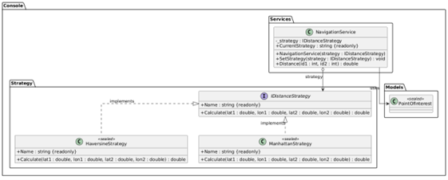
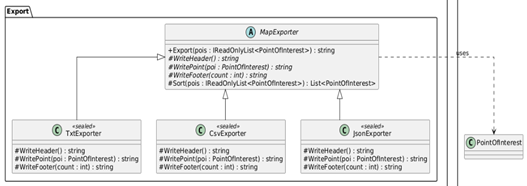
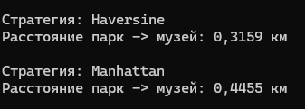
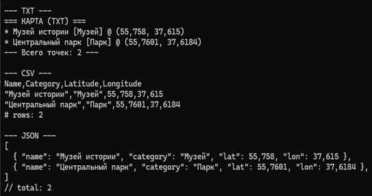

# Лабораторная работа 11. Поведенческие паттерны: Стратегия, Шаблонный метод

## Паттерн

**Strategy (Стратегия)** и **Template Method (Шаблонный метод)** — поведенческие паттерны GoF.

## Что было сделано

Реализованы два поведенческих паттерна, решающих разные задачи в консольном приложении «Интерактивная карта»:

- **Strategy** — [`IDistanceStrategy.cs`](https://github.com/uu546/DesignPatternLabDerevyashkinVV/blob/main/InteractiveMap.Console/Strategy/IDistanceStrategy.cs) задаёт общий интерфейс алгоритмов расчёта расстояния. Конкретные стратегии — [`HaversineStrategy.cs`](https://github.com/uu546/DesignPatternLabDerevyashkinVV/blob/main/InteractiveMap.Console/Strategy/HaversineStrategy.cs) (расстояние по формуле гаверсинуса) и [`ManhattanStrategy.cs`](https://github.com/uu546/DesignPatternLabDerevyashkinVV/blob/main/InteractiveMap.Console/Strategy/ManhattanStrategy.cs) (манхэттенское приближение по сетке). Context — [`NavigationService.cs`](https://github.com/uu546/DesignPatternLabDerevyashkinVV/blob/main/InteractiveMap.Console/Services/NavigationService.cs) — хранит ссылку на текущую стратегию и позволяет менять её в рантайме через `SetStrategy`.
- **Template Method** — [`MapExporter.cs`](https://github.com/uu546/DesignPatternLabDerevyashkinVV/blob/main/InteractiveMap.Console/Export/MapExporter.cs) задаёт финальный скелет алгоритма экспорта карты (`Export`): сортировка → заголовок → точки → подвал. Изменяемые шаги (`WriteHeader`, `WritePoint`, `WriteFooter`) переопределяются подклассами. Конкретные экспортёры — [`TxtExporter.cs`](https://github.com/uu546/DesignPatternLabDerevyashkinVV/blob/main/InteractiveMap.Console/Export/TxtExporter.cs), [`CsvExporter.cs`](https://github.com/uu546/DesignPatternLabDerevyashkinVV/blob/main/InteractiveMap.Console/Export/CsvExporter.cs), [`JsonExporter.cs`](https://github.com/uu546/DesignPatternLabDerevyashkinVV/blob/main/InteractiveMap.Console/Export/JsonExporter.cs) — реализуют шаги для соответствующего формата.

## Диаграмма классов

Взаимозаменяемые стратегии расчёта расстояния

Шаблонный метод экспорта

## Скриншоты работы

Strategy

Template Method

## Связь с предметной областью

В приложении «Интерактивная карта» стратегия позволяет переключать способ расчёта расстояния (по прямой, по сетке) без изменения клиентского кода — например, для разных режимов навигации. Шаблонный метод задаёт единый скелет экспорта карты в разные форматы (TXT, CSV, JSON): общая логика (сортировка, порядок вывода) — в базовом классе, а специфика формата — в наследниках.