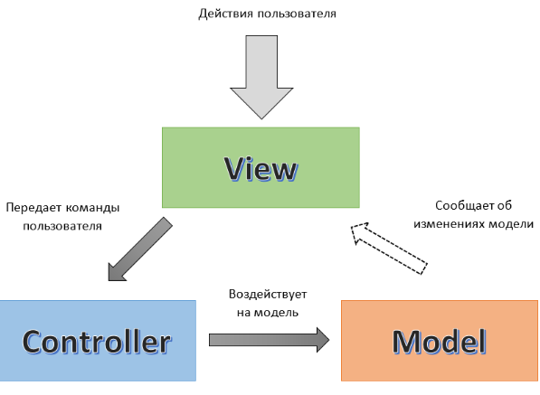

# Лабораторная работа 12. Архитектурные паттерны: MVC

## Паттерн

**MVC (Model–View–Controller)** — архитектурный паттерн.

## Что было сделано

Разобран архитектурный паттерн **MVC** на базе стандартного шаблона ASP.NET Core MVC от Microsoft:

- **Controller** — [`HomeController.cs`](https://github.com/uu546/DesignPatternLabDerevyashkinVV/blob/main/Lr12.Mvc/Controllers/HomeController.cs) — обрабатывает HTTP-запросы, выбирает View и передаёт в него Model. Не содержит бизнес-логики.
- **Model** — [`ErrorViewModel.cs`](https://github.com/uu546/DesignPatternLabDerevyashkinVV/blob/main/Lr12.Mvc/Models/ErrorViewModel.cs) — данные, передаваемые между Controller и View. Не знает ни о HTTP, ни о View.
- **View** — [`Index.cshtml`](https://github.com/uu546/DesignPatternLabDerevyashkinVV/blob/main/Lr12.Mvc/Views/Home/Index.cshtml), [`Privacy.cshtml`](https://github.com/uu546/DesignPatternLabDerevyashkinVV/blob/main/Lr12.Mvc/Views/Home/Privacy.cshtml) — Razor-шаблоны, отвечающие только за отображение. Общий каркас страниц вынесен в [`_Layout.cshtml`](https://github.com/uu546/DesignPatternLabDerevyashkinVV/blob/main/Lr12.Mvc/Views/Shared/_Layout.cshtml).

Поток запроса: `HTTP → Routing → Controller → Model → View → HTML`. Роль инфраструктуры (Routing, ModelBinding, DI) берёт на себя ASP.NET Core — наша задача состояла в правильном распределении ответственностей по слоям MVC.

## Диаграмма классов

Слои MVC в шаблоне ASP.NET Core

## Связь с предметной областью

В контексте «Интерактивной карты» MVC — это архитектурный каркас для веб-представления предметной области: Model описывает точки интереса, View отображает их пользователю, Controller обрабатывает запросы (список точек, карточка точки, добавление). Паттерн разделяет отображение и управление, что позволяет независимо менять UI и бизнес-логику.
