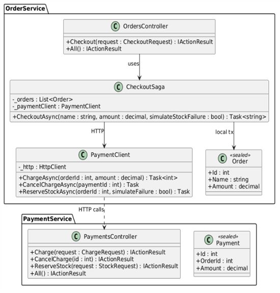

# Лабораторная работа 13. Паттерны микросервисов: Saga (Orchestration)

## Паттерн

**Saga (Orchestration)** — паттерн микросервисов и распределённых систем.

## Что было сделано

Реализован паттерн **Saga** с подходом **оркестрации** для оформления заказа в двух микросервисах:

- **`OrderService.Api`** — микросервис заказов. Оркестратор — [`CheckoutSaga.cs`](https://github.com/uu546/DesignPatternLabDerevyashkinVV/blob/main/Lr13.Microservices/OrderService.Api/Sagas/CheckoutSaga.cs) — знает последовательность шагов Saga и компенсаций. Контроллер [`OrdersController.cs`](https://github.com/uu546/DesignPatternLabDerevyashkinVV/blob/main/Lr13.Microservices/OrderService.Api/Controllers/OrdersController.cs) — точка входа, HTTP-клиент [`PaymentClient.cs`](https://github.com/uu546/DesignPatternLabDerevyashkinVV/blob/main/Lr13.Microservices/OrderService.Api/HttpClients/PaymentClient.cs) — вызовы PaymentService, модель [`Order.cs`](https://github.com/uu546/DesignPatternLabDerevyashkinVV/blob/main/Lr13.Microservices/OrderService.Api/Models/Order.cs).
- **`PaymentService.Api`** — микросервис оплат. Контроллер [`PaymentsController.cs`](https://github.com/uu546/DesignPatternLabDerevyashkinVV/blob/main/Lr13.Microservices/PaymentService.Api/Controllers/PaymentsController.cs) — операции `Charge` (шаг 2), `CancelCharge` (компенсация шага 2) и `ReserveStock` (шаг 3, имитация склада). Модель [`Payment.cs`](https://github.com/uu546/DesignPatternLabDerevyashkinVV/blob/main/Lr13.Microservices/PaymentService.Api/Models/Payment.cs).

**Сценарий Saga** — три шага, каждый с компенсацией:

1. Создать заказ (`OrderService`).
2. Списать оплату (`PaymentService`).
3. Зарезервировать товар (`PaymentService`).

При отказе шага 3 оркестратор запускает **компенсации в обратном порядке**: возврат оплаты → отмена заказа. Каждый шаг оформлен как `try/catch` с собственной компенсационной логикой. Данные в двух разных БД остаются согласованными.

## Диаграмма классов

Saga с оркестрацией между OrderService и PaymentService

## Связь с предметной областью

В контексте «Интерактивной карты» Saga решает проблему распределённых транзакций между двумя сервисами, каждый со своей БД. Например, оформление заказа на бронирование экскурсии на карте затрагивает и сервис заказов, и сервис оплат — Saga гарантирует, что при отказе одного из шагов система откатится к согласованному состоянию через компенсации, без ACID-транзакции между сервисами.
