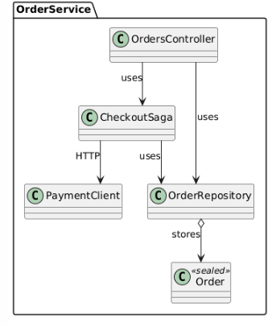

# Лабораторная работа 14. Системные паттерны: Repository

## Паттерн

**Repository** — системный паттерн работы с данными.

## Что было сделано

Реализован паттерн **Repository** для работы с заказами в `OrderService.Api`:

- [`OrderRepository.cs`](https://github.com/uu546/DesignPatternLabDerevyashkinVV/blob/main/Lr13.Microservices/OrderService.Api/Repositories/OrderRepository.cs) — промежуточный класс между бизнес-логикой и хранилищем заказов. Инкапсулирует:
  - само хранилище (`List<Order>`);
  - генерацию `Id` (`_nextId++`);
  - создание заказа (`Create(name, amount)`);
  - удаление (`Remove(id)`);
  - чтение (`All`).

- [`CheckoutSaga.cs`](https://github.com/uu546/DesignPatternLabDerevyashkinVV/blob/main/Lr13.Microservices/OrderService.Api/Sagas/CheckoutSaga.cs) — оркестратор Saga — переведён на работу через `OrderRepository`: вместо прямого манипулирования списком вызывает `_orders.Create(...)` и `_orders.Remove(...)`. Бизнес-логика больше не знает о структуре хранения.
- [`OrdersController.cs`](https://github.com/uu546/DesignPatternLabDerevyashkinVV/blob/main/Lr13.Microservices/OrderService.Api/Controllers/OrdersController.cs) — использует `_orders.All` вместо прямого доступа к списку.

## Диаграмма классов

Repository между бизнес-логикой и хранилищем заказов

## Связь с предметной областью

В контексте «Интерактивной карты» репозиторий изолирует бизнес-логику от деталей хранения точек и заказов. Оркестратор Saga и контроллер работают с репозиторием как с коллекцией доменных объектов, не зная, лежит ли за ней in-memory-список, SQL-база или внешний сервис. Это позволяет менять способ хранения, не затрагивая бизнес-код.