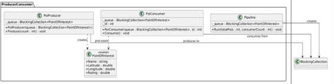
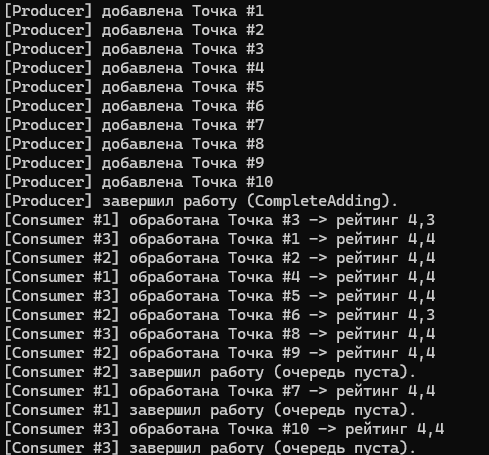

# Лабораторная работа 15. Идиоматические паттерны: Producer/Consumer

## Паттерн

**Producer/Consumer (Производитель–Потребитель)** — идиоматический паттерн.

## Что было сделано

Реализован паттерн **Producer/Consumer** в консольном приложении для параллельной обработки точек интереса:

- **Producer** — [`PoiProducer.cs`](https://github.com/uu546/DesignPatternLabDerevyashkinVV/blob/main/Lr15/PoiProducer.cs) — генерирует точки и кладёт их в очередь. По завершении вызывает `CompleteAdding()` — сигнал консьюмерам, что новых задач не будет.
- **Consumer** — [`PoiConsumer.cs`](https://github.com/uu546/DesignPatternLabDerevyashkinVV/blob/main/Lr15/PoiConsumer.cs) — три параллельных воркера забирают точки из очереди через `GetConsumingEnumerable()` и обрабатывают (имитация долгой работы через `Thread.Sleep(200)` + присвоение «фейкового» рейтинга).
- **Queue** — `BlockingCollection<PointOfInterest>` — стандартная потокобезопасная очередь .NET.
- **Coordinator** — [`Pipepline.cs`](https://github.com/uu546/DesignPatternLabDerevyashkinVV/blob/main/Lr15/Pipepline.cs) — создаёт очередь, запускает продюсера и N консьюмеров, ждёт завершения всех.
- **Модель** — [`PointOfInterest.cs`](https://github.com/uu546/DesignPatternLabDerevyashkinVV/blob/main/Lr15/PointOfInterest.cs) — упрощённая доменная сущность.
- **Точка входа** — [`Program.cs`](https://github.com/uu546/DesignPatternLabDerevyashkinVV/blob/main/Lr15/Program.cs).

Благодаря параллельной обработке 10 точек на 3 воркерах обрабатываются за ~800 мс вместо 2000 мс при последовательном выполнении.

## Диаграмма классов

Производитель, очередь и три потребителя

## Скриншоты работы

## Связь с предметной областью

В контексте «Интерактивной карты» Producer/Consumer позволяет параллельно обрабатывать точки интереса при загрузке карты: продюсер быстро кладёт точки в очередь, а несколько консьюмеров одновременно обрабатывают их — рассчитывают рейтинг, расстояния до центра, дополнительные атрибуты. Очередь увеличивает скорости производства и даёт естественное распараллеливание между consumer.
